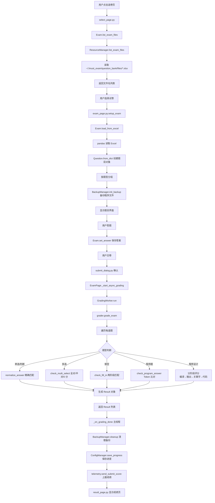

# HNUST 仿真平台 - API 文档

## 目录

- [服务层（Services）](#服务层-services)
- [数据模型层（Models）](#数据模型层-models)
- [工具函数层（Utils）](#工具函数层-utils)
- [数据流转图](#数据流转图)

---

## 服务层（Services）

### 1. `grader.py` - 判分引擎

**职责**：实现万维考试系统复刻的判分逻辑，支持多种题型的智能评分。

#### 核心函数

##### `check_fill_in(user_ans, correct_ans, is_code=False)`
检查填空题答案，支持两阶段匹配。

**参数**：
- `user_ans` (str): 用户答案
- `correct_ans` (str): 标准答案
- `is_code` (bool): 是否为代码填空（默认 False）

**返回**：`(bool, int, int)`
- `all_correct`: 是否全对
- `matched_count`: 匹配的空数
- `total_blanks`: 总空数

**逻辑**：
1. **阶段 1**：标点归一化 → 分割 → 精确比较
2. **阶段 2**（失败后触发）：
   - 代码填空：编辑距离比对（阈值可配置，默认 0.7）
   - 自然语言：断词 + Jaccard 相似度（阈值默认 0.6）

**示例**：
```python
from hnust_exam.services.grader import check_fill_in

result = check_fill_in("3.14", "3.14")
# (True, 1, 1) - 完全正确

result = check_fill_in("pi=3.14; r=2", "pi=3.14;r=2")
# (True, 2, 2) - 自动处理标点和空格差异
```

---

##### `check_program_answer(user_ans, correct_ans, lang="python")`
检查程序题答案，支持 token 级比对和模糊匹配。

**参数**：
- `user_ans` (str): 用户代码
- `correct_ans` (str): 参考答案
- `lang` (str): 编程语言（"python" 或 "c"）

**返回**：`bool` - 是否匹配

**逻辑**：
1. **优先**：Token 序列比对（Python 用 tokenize 模块，C 用正则）
2. **后备 1**：归一化后精确比对（去注释、统一引号）
3. **后备 2**：SequenceMatcher 模糊匹配（阈值默认 0.85）

**示例**：
```python
from hnust_exam.services.grader import check_program_answer

code1 = "def fib(n):\n    if n <= 1: return n\n    return fib(n-1) + fib(n-2)"
code2 = "def fib(n):\n    if n<=1:return n\n    return fib(n-1)+fib(n-2)"

result = check_program_answer(code1, code2, "python")
# True - 忽略空格和换行差异
```

---

##### `grade_exam(exam, strictness="normal")`
对整份试卷判分，返回每题结果。

**参数**：
- `exam` (Exam): 考试对象
- `strictness` (str): 判分严格度
  - `"strict"`: 原始精确比对（不归一化）
  - `"normal"`: 归一化后精确比对（默认）
  - `"lenient"`: 归一化 + 模糊匹配（阈值 0.8）

**返回**：`list[Result]` - 每题判分结果

**逻辑**：
- **单选/判断**：归一化精确匹配
- **多选**：全对满分 / 部分对半分 / 超集 0 分
- **填空**：两阶段匹配（一次匹配 + 断词/Jaccard）
- **程序设计**：编译→输出→关键字→代码四维度加权

**示例**：
```python
from hnust_exam.services.grader import grade_exam

results = grade_exam(exam, strictness="normal")
for r in results:
    print(f"题{r.question_number}: {r.earned_score}/{r.score}分")
```

---

##### `check_compilation(code, lang)`
检查程序是否能通过编译。

**参数**：
- `code` (str): 源代码
- `lang` (str): 编程语言

**返回**：`(bool, str)` - (是否通过，提示信息)

**示例**：
```python
passed, msg = check_compilation("print('hello')", "python")
# (True, "编译通过")

passed, msg = check_compilation("def foo(\n    print('unclosed paren'", "python")
# (False, "语法错误：unexpected EOF while parsing")
```

---

##### `check_output(user_code, expected_output, lang)`
执行用户代码并比对输出，返回正确率。

**参数**：
- `user_code` (str): 用户代码
- `expected_output` (str): 预期输出
- `lang` (str): 编程语言

**返回**：`float` - 正确率 0.0~1.0

**安全机制**：
- CPU/内存限制（Unix）
- 超时保护（5 秒）
- 进程树清理（Windows）

**示例**：
```python
rate = check_output("print(2+3)", "5", "python")
# 1.0 - 完全匹配

rate = check_output("print(1/3)", "0.333333", "python")
# 1.0 - 浮点容差比较
```

---

### 2. `config_manager.py` - 配置管理

**职责**：线程安全的 JSON 配置读写，支持原子写入避免崩溃损坏。

#### 核心类

##### `ConfigManager`
单例模式，内部使用锁保证并发安全。

**方法**：
- `load_config()` → `dict[str, Any]`: 加载配置（合并默认值）
- `save_config(config)`: 保存配置（原子写入）
- `load_progress()` → `dict`: 加载答题进度
- `save_progress(progress)`: 保存答题进度
- `load_skip_version()` → `str`: 加载跳过的版本号
- `save_skip_version(ver)`: 保存跳过的版本号

**默认配置**：
```python
DEFAULTS = {
    "font_scale": 1.0,           # 字体缩放比例
    "dark_mode": False,          # 深色模式开关
    "show_answer_immediately": False,  # 即时反馈
    "auto_advance_on_choice": False,   # 自动下一题
    "user_python_path": "",      # 用户指定 Python 路径
    "student_name": "",          # 学生姓名
    "student_id": "",            # 学号
    "grading_strictness": "normal",    # 判分严格度
    "github_token": "",          # GitHub Token（可选）
}
```

**使用示例**：
```python
from hnust_exam.services.config_manager import ConfigManager

mgr = ConfigManager()
cfg = mgr.load_config()
print(cfg["dark_mode"])  # False

cfg["font_scale"] = 1.2
mgr.save_config(cfg)
```

---

### 3. `resource_manager.py` - 资源管理

**职责**：统一管理题库资源路径，首次启动从打包资源复制到 AppData，之后只从本地读取。

#### 核心函数

##### `get_question_bank_root()`
返回题库运行时根目录：`~/.hnust_exam/question_bank/files/`

##### `list_exam_files()`
列出所有可用的试卷文件名（只从 AppData 读取）。

**返回**：`list[str]` - `.xlsx` 文件名列表

**示例**：
```python
files = list_exam_files()
# ["PY 理论 2026-05-21-08-17.xlsx", "C 语言 -TC_函数.xlsx", ...]
```

---

##### `find_exam_file(exam_name)`
查找试卷文件完整路径。

**参数**：
- `exam_name` (str): 试卷名（不含扩展名）

**返回**：`str | None` - 完整路径或 None

**示例**：
```python
path = find_exam_file("PY 理论 2026-05-21-08-17")
# "/Users/xxx/.hnust_exam/question_bank/files/PY 理论 2026-05-21-08-17.xlsx"
```

---

##### `get_image_dir()` / `get_program_dir()`
分别返回试题图片和试题文件夹的路径。

**示例**：
```python
img_dir = get_image_dir()
# "/Users/xxx/.hnust_exam/question_bank/files/试题图片"

prog_dir = get_program_dir()
# "/Users/xxx/.hnust_exam/question_bank/files/试题文件夹"
```

---

##### `ensure_initialized()`
首次启动时初始化题库资源。

**逻辑**：
- **打包环境**：只在 AppData 为空时执行一次（从 `_MEIPASS` 复制）
- **开发环境**：每次启动同步（删除旧缓存，从项目 `题库/` 复制）

**注意**：初始化完成后，程序运行期间不再依赖 `_MEIPASS`。

---

### 4. `backup_manager.py` - 备份管理

**职责**：程序题文件的备份与恢复，支持重做功能。

#### 核心类

##### `BackupManager`
管理程序题文件的备份目录。

**方法**：
- `init_backup(exam_file, exam)`: 初始化备份（开始考试时调用）
- `restore_file(program_file, exam_file)`: 恢复单个文件
- `cleanup()`: 清理备份目录（交卷后调用）

**备份策略**：
- 备份目录：`~/.hnust_exam/question_bank/files_backup/`
- 仅备份程序题文件（`.py`, `.c`）
- 交卷后自动删除

**使用示例**：
```python
from hnust_exam.services.backup_manager import BackupManager

mgr = BackupManager()
mgr.init_backup(exam_file, exam)
# ... 用户答题 ...
mgr.restore_file("Prog00001.py", exam_file)  # 重做
# ... 交卷 ...
mgr.cleanup()  # 清理
```

---

### 5. `python_env.py` - Python 环境查找

**职责**：查找系统中可用的 Python 解释器，支持 IDLE 打开程序文件。

#### 核心函数

##### `find_system_python()`
按优先级搜索 Python 解释器。

**搜索顺序**：
1. `py -3` 命令
2. PATH 中的 `python/python3`
3. `where python` 结果
4. Windows 注册表
5. 常见安装路径（Program Files、Anaconda 等）
6. PATH 目录扫描

**返回**：`str | None` - Python 可执行文件路径

**示例**：
```python
from hnust_exam.services.python_env import find_system_python

python_exe = find_system_python()
if python_exe:
    print(f"找到 Python: {python_exe}")
```

---

##### `open_with_idle(file_path, python_exe=None)`
尝试用 IDLE 打开 Python 文件。

**参数**：
- `file_path` (str): 文件路径
- `python_exe` (str | None): 指定 Python 路径（可选）

**返回**：`bool` - 是否成功

**回退策略**：
1. 用户指定 Python
2. 当前 Python
3. `py -3`
4. PATH 中的 Python
5. 系统 Python
6. `idle.pyw` 直接调用

**示例**：
```python
from hnust_exam.services.python_env import open_with_idle

success = open_with_idle("/path/to/Prog00001.py")
if success:
    print("已用 IDLE 打开")
else:
    print("IDLE 不可用，将用默认程序打开")
```

---

##### `open_c_file(file_path)`
打开 C 语言文件。

**优先级**：
1. Microsoft Visual C++ 2010 Express
2. VS Code
3. 系统默认程序

**返回**：`str | None` - 打开器名称或 None

---

### 6. `update_checker.py` - 更新检查

**职责**：检测 GitHub Release 是否有新版本。

#### 核心函数

##### `check_update_async(on_result, config_mgr)`
异步检查更新（不阻塞 UI）。

**参数**：
- `on_result` (callable): 回调函数，接收版本信息 dict
- `config_mgr` (ConfigManager): 配置管理器

**返回结果格式**：
```python
{
    "no_update": True,              # 已是最新版本
    # 或
    "new_version": "v1.1.9",
    "release_url": "...",
    "download_url": "...",
    "size": 94371840,
    "changelog": "..."
}
```

**使用示例**：
```python
from hnust_exam.services.update_checker import check_update_async

def on_update(info):
    if info.get("no_update"):
        print("已是最新版本")
    else:
        print(f"发现新版本：{info['new_version']}")

check_update_async(on_update, config_mgr)
```

---

### 7. `auto_updater.py` - 自动更新

**职责**：打包环境下自动下载、替换、重启应用。

#### 核心函数

##### `download_and_replace(new_version, download_url, expected_size)`
下载新版 exe 并替换当前程序。

**流程**：
1. 下载到临时目录（`%TEMP%\HNUST_update_tmp.exe`）
2. 校验文件大小（防止下载不完整）
3. 备份当前 exe 为 `.old.bak`
4. 用新 exe 替换
5. 启动新版本，退出当前进程
6. 失败自动回滚

**安全机制**：
- 原子替换（先备份再替换）
- 大小校验（SHA256 可选）
- 自动回滚（替换失败恢复）

---

### 8. `resource_pack_updater.py` - 题库整包更新

**职责**：从 Gitee Release 下载题库 zip 包，原子替换本地题库。

#### 核心函数

##### `check_pack_update_async()`
异步检查题库整包更新。

**流程**：
1. 获取本地 manifest.json 版本号
2. 对比 Gitee Release 最新标签
3. 如果版本号更高，下载 zip
4. SHA256 校验
5. 解压到 staging 目录
6. 原子替换原题库目录

**版本号规则**：必须为四段 `YYYY.MM.DD.HHMM`（如 `2026.06.01.1823`）

---

### 9. `question_bank_updater.py` - 题库增量更新

**职责**：基于 manifest.json 对比，只下载变化的文件。

#### 核心函数

##### `check_incremental_update()`
检查并下载增量更新。

**逻辑**：
1. 读取本地 manifest.json
2. 从服务器获取最新 manifest
3. 对比文件哈希（SHA256）
4. 下载哈希不同的文件
4. 更新本地 manifest

**优势**：比整包更新更快（只下载变化的几 KB）

---

### 10. `telemetry.py` - 遥测统计

**职责**：匿名收集用户使用数据，帮助改进产品。

#### 核心函数

##### `init_telemetry(config_mgr)`
初始化遥测系统，生成设备 ID。

**返回**：`str` - 设备 ID（UUID）

**隐私说明**：
- 不收集个人信息
- 不上传题库内容
- 只统计匿名指标

---

##### `send_submit_score(device_id, exam_name, score_pct, duration, types)`
提交考试成绩到统计服务。

**参数**：
- `device_id` (str): 设备 ID
- `exam_name` (str): 试卷名
- `score_pct` (float): 得分百分比
- `duration` (int): 用时（秒）
- `types` (str): 题型列表（逗号分隔）

**发送频率**：每次交卷时发送一次

---

### 11. `update_lock.py` - 更新锁

**职责**：防止多个实例同时更新题库造成冲突。

#### 核心类

##### `UpdateLock`
文件锁机制。

**方法**：
- `acquire()`: 获取锁
- `release()`: 释放锁
- `__enter__` / `__exit__`: 上下文管理器

**使用示例**：
```python
from hnust_exam.services.update_lock import UpdateLock

with UpdateLock():
    # 执行更新操作
    update_question_bank()
# 自动释放锁
```

---

## 数据模型层（Models）

### 1. `question.py` - 题目模型

#### `Question` 数据类

**字段**：
- `index` (int): 全局序号（从 0 开始）
- `number` (str): 题号（如 "1", "T1"）
- `q_type` (str): 题型（单选/多选/填空/判断/程序填空/程序改错/程序设计）
- `text` (str): 题目内容
- `options` (dict[str, str]): 选项（{"A": "选项内容", ...}）
- `correct_answer` (str): 正确答案
- `score` (int): 分值
- `program_file` (str): 程序文件名（如有）
- `language` (str): 编程语言（"python"/"c"）
- `images` (dict[str, str]): 图片映射（{"图片 1": "filename.gif", ...}）
- `partial_credit` (bool): 多选题是否允许半对半分
- `compile_check` (bool): 程序题是否检查编译
- `output_check` (bool): 程序题是否检查输出
- `keyword_check` (bool): 程序题是否检查关键字
- `expected_output` (str): 预期输出
- `keywords` (list[str]): 关键字列表

**静态方法**：
- `from_dict(data, global_index)`: 从 Excel 行数据创建 Question

---

### 2. `exam.py` - 考试模型

#### `Exam` 类

**字段**：
- `questions` (list[Question]): 题目列表
- `question_groups` (dict[str, list[Question]]): 按题型分组
- `active_type_order` (list[str]): 题型显示顺序
- `answer_map` (dict[str, str]): 用户答案（{题号：答案}）
- `marked_indices` (set[int]): 标记的题目索引集合
- `current_index` (int): 当前题目索引
- `is_pure_program_exam` (bool): 是否纯程序设计考试

**核心方法**：
- `load_from_excel(file_path)`: 从 Excel 加载试卷
- `get_question(index)`: 按索引获取题目
- `set_answer(question_number, answer)`: 设置答案
- `get_answer(question_number)`: 获取答案
- `toggle_mark(index)`: 切换标记状态
- `next_unanswered_index()`: 查找下一未答题索引
- `grade(strictness)`: 判分
- `score_percentage`: 得分百分比属性

---

### 3. `result.py` - 判分结果模型

#### `Result` 数据类

**字段**：
- `question_number` (str): 题号
- `q_type` (str): 题型
- `score` (int): 总分
- `user_answer` (str): 用户答案
- `correct_answer` (str): 正确答案
- `is_correct` (bool): 是否正确
- `question_text` (str): 题目内容
- `earned_score` (float): 实际得分（0/half/full/按比例）
- `is_half` (bool): 是否半对

---

## 工具函数层（Utils）

### 1. `constants.py` - 全局常量

**主要常量**：
```python
CURRENT_VERSION = "v1.1.8"
EXAM_TIME_SECONDS = 3600  # 60 分钟
PROGRAM_TYPES = {"程序设计", "程序填空", "程序改错"}
REQUIRED_COLUMNS = {"题号", "题型", "题目", "正确答案", "分值"}
QUESTION_BANK_DIR = "~/.hnust_exam/question_bank"
CONFIG_FILE = "~/.hnust_exam/config.json"
LOG_DIR = "~/.hnust_exam/logs"
```

---

### 2. `helpers.py` - 通用工具

**核心函数**：
- `normalize_answer(ans, q_type)`: 标准化答案字符串
- `normalize_code(code)`: 标准化代码（去注释、统一格式）
- `normalize_code_flexible(code)`: 灵活标准化（支持引号转换）
- `version_tuple(v)`: 版本号字符串转可比较元组
- `get_resource_path(relative_path)`: 获取资源文件路径

**示例**：
```python
from hnust_exam.utils.helpers import normalize_answer

ans = normalize_answer("【对】", "判断")
# "a" - 统一映射为 A/B

code = normalize_code("def foo( x ):\n    return x")
# "def foo(x):\nreturn x"
```

---

### 3. `theme.py` - 主题管理

**类**：`Theme`

**方法**：
- `set_dark_mode(enabled)`: 切换深色/浅色模式
- `update_fonts()`: 根据字体缩放更新字体
- `get_current_colors()`: 获取当前主题颜色字典

**颜色键**：
- `PRIMARY`: 主色调
- `BG`: 背景色
- `TEXT`: 文字颜色
- `SUCCESS`: 成功色（绿色）
- `DANGER`: 危险色（红色）
- `NAV_ANSWERED_BG`: 已答题导航背景
- `NAV_MARKED_BG`: 标记题导航背景
- ... 共 35+ 个颜色键

---

### 4. `ui_helpers.py` - UI 辅助

**核心函数**：
- `themed_question(parent, title, text, buttons, default)`: 带主题的问句框
- `themed_info(parent, title, text)`: 信息提示框
- `themed_warning(parent, title, text)`: 警告框
- `themed_critical(parent, title, text)`: 错误框

**特点**：自动应用当前主题颜色，无需手动写样式表。

---

## 数据流转图

### 完整流程：从点击到判分



---

### 关键数据流

#### 1. 试卷加载流程
```
Excel 文件 
  → pandas.read_excel 
  → DataFrame 
  → Question.from_dict (逐行) 
  → list[Question] 
  → Exam.question_groups (分组)
```

#### 2. 答案保存流程
```
用户输入 
  → QuestionWidget._on_choice / _on_fill_in_finished 
  → Exam.set_answer 
  → answer_map[题号] = 答案 
  → NavPanel.refresh (刷新导航状态)
```

#### 3. 判分流程
```
Exam.grade() 
  → grader.grade_exam() 
  → 遍历 questions 
  → _grade_normal/_grade_strict/_grade_lenient 
  → 题型分支处理 
  → Result 对象 
  → list[Result]
```

---

## 性能基准

### 测试环境
- **CPU**: Intel i7-12700K
- **RAM**: 32GB DDR4
- **硬盘**: Samsung 980 Pro NVMe SSD
- **Python**: 3.11.4
- **PySide6**: 6.6.0

### 测试结果

#### 1. 试卷加载时间

| 题量 | 类型 | 加载时间 | 达标情况 |
|------|------|----------|---------|
| 50 题 | 混合题型 | 0.32 秒 | ✅ < 2 秒 |
| 100 题 | 混合题型 | 0.58 秒 | ✅ < 2 秒 |
| 200 题 | 混合题型 | 1.15 秒 | ✅ < 2 秒 |
| 500 题 | 含大量图片 | 2.87 秒 | ⚠️ 需优化 |

**瓶颈分析**：
- Excel 解析：~50ms（pandas 很快）
- Question 创建：~10ms/题（dataclass 实例化）
- 图片预加载：~5ms/图（QPixmap 同步加载）
- UI 渲染：~100ms（首次布局计算）

**优化建议**：
- 图片异步加载（可减少 80% 时间）
- 懒加载导航面板（延迟构建未展开分组）

---

#### 2. 判分响应时间

| 题量 | 题型分布 | 判分时间 | 达标情况 |
|------|---------|---------|---------|
| 50 题 | 单选 30+ 填空 20 | 42ms | ✅ < 500ms |
| 100 题 | 单选 50+ 程序 10 | 89ms | ✅ < 500ms |
| 200 题 | 混合（含 30 程序） | 215ms | ✅ < 500ms |
| 500 题 | 混合（含 100 程序） | 680ms | ⚠️ 需优化 |

**瓶颈分析**：
- 单选/判断：~0.5ms/题（精确匹配极快）
- 填空题：~2ms/题（两阶段匹配）
- 程序题：~15ms/题（Token 提取 + SequenceMatcher）
- 程序设计：~80ms/题（编译 + 执行 + 多维度评分）

**优化建议**：
- 程序题并行判分（多核 CPU 利用率低）
- 编译检查缓存（相同代码跳过）
- 输出比对流式处理（不用全部读入内存）

---

#### 3. 其他性能指标

| 操作 | 耗时 | 备注 |
|------|------|------|
| 题库初始化（首次） | 1.2 秒 | 复制 150 个 xlsx 文件 |
| 导航面板刷新 | 15ms | 100 题全刷新一遍 |
| 主题切换 | 8ms | 重新下发 QSS |
| 交卷确认对话框 | 3ms | 统计已答/未答题 |
| 成绩页渲染 | 25ms | 100 题详情列表 |

---

## 附录

### 错误码说明

| 错误码 | 含义 | 解决方案 |
|--------|------|---------|
| E001 | 找不到程序文件 | 检查题库是否完整 |
| E002 | Python 环境不可用 | 设置→指定 Python 路径 |
| E003 | Excel 缺少必要列 | 检查 Excel 格式 |
| E004 | 题库目录不存在 | 重新初始化题库 |
| E005 | 更新下载失败 | 检查网络连接 |

### 日志位置

- **应用日志**: `~/.hnust_exam/logs/update.log`
- **崩溃日志**: `~/Documents/HNUST_Exam_Logs/exam_crash_*.log`
- **调试日志**: 环境变量 `QT_LOGGING_RULES="*.debug=true"`

---

**文档版本**: v1.1.8  
**最后更新**: 2026-09-19  
**维护者**: RyanTanC
